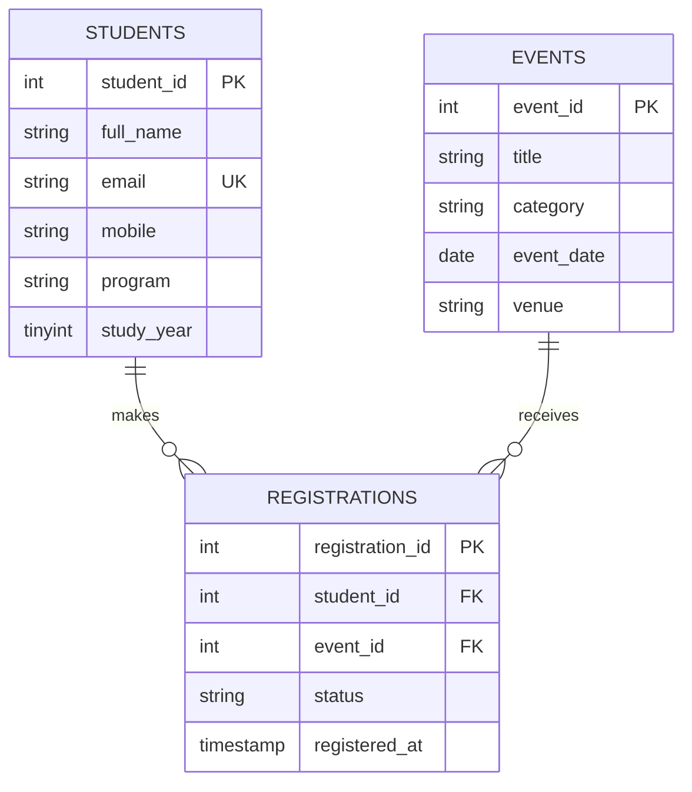

# Practical 8: MySQL Schema Design, ER Model, PDO Connectivity, and Prepared Statements

## Objective
Design the StudentHub students, events, and registrations tables; show their relationships; seed sample records; and connect PHP to MySQL with PDO and a native prepared statement.

## ER model

The registrations table resolves the many-to-many relationship between students and events. Each student's and event's details are stored once; registrations refer to them using foreign keys. A unique student/event pair prevents duplicate registrations.

## Files and connectivity
- `sql/studenthub.sql` creates the database, normalized tables, primary/foreign/unique keys, indexes, and synthetic seed rows.
- `db.php` creates a PDO connection with UTF-8, exceptions, associative fetches, and native prepared statements.
- `connection-test.php` runs a parameterized count query and shows a friendly connection result.
- The existing `PRACTICAL-02/dashboard.php` links to the connection check.

## Setup with XAMPP
1. Start MySQL in the XAMPP Control Panel.
2. Open phpMyAdmin at `http://localhost/phpmyadmin` and import `PRACTICAL-08/sql/studenthub.sql` using the Import tab.
3. The default local settings are host `127.0.0.1`, port `3306`, database `studenthub`, user `root`, and an empty password. `db.php` also accepts `STUDENTHUB_DB_HOST`, `STUDENTHUB_DB_PORT`, `STUDENTHUB_DB_NAME`, `STUDENTHUB_DB_USER`, and `STUDENTHUB_DB_PASSWORD` environment variables. Use local-only credentials; do not commit passwords.
4. Run the PHP server from the project root using the Practical 7 router, then sign in with the demo student account, open `http://127.0.0.1:8000/PRACTICAL-02/dashboard.php`, and choose the PDO connection check.

PowerShell server command:

    C:\xampp\php\php.exe -S 127.0.0.1:8000 -t . PRACTICAL-07/router.php

## Viva notes
Explain entities, primary/foreign keys, the junction table, referential integrity, PDO exception mode, DSN charset, and the named parameter in the prepared query.

## Screenshots
The successful PDO connection test against the imported local XAMPP database is captured in `PRACTICAL-08/screenshots/pdo-connection-success.png`.

